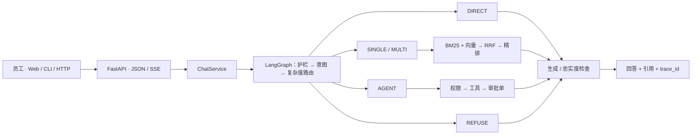

<h1 align="center">IT Helpdesk Agent</h1>

<p align="center"><strong>企业内部 IT 服务台智能体：查工单、查设备、查 SOP，并把权限 / 软件 / 密码申请变成可审批的写操作。</strong></p>

<p align="center">
  
  
  
  
</p>

---

## 这是什么

员工遇到 IT 问题时的“内部客服”：电脑坏了、VPN 连不上、要开权限、要装软件、想知道工单到哪了。

系统先判断问题类型，再决定走哪条路：

| 员工说 | 策略 | 系统做什么 |
|:---|:---:|:---|
| 你好 | `DIRECT` | 直接回答，不检索 |
| VPN 怎么申请 | `SINGLE` | 检索一篇 SOP，带引用回答 |
| 离职账号怎么回收，外包和正式有区别吗 | `MULTI` | 拆成多跳，跨文档拼证据 |
| TKT10001 处理到哪了 | `AGENT` | 调 `get_ticket` 查真实工单 |
| 帮我申请 CRM 客户导出权限 | `AGENT` | 生成审批单，人工确认后才提交 |
| 帮我写作业 | `REFUSE` | 越界拒答 |

## 和玩具 RAG 的区别

| 维度 | 常见做法 | 本项目 |
|:---|:---|:---|
| 路由 | 所有问题走向量检索 | 五路分流，问候不检索，越权直接拒答 |
| 召回 | 单路向量 top-k | BM25（标题+小节）+ bge-small + RRF |
| 多跳 | 一次检索定结果 | 改写、补检，最多 3 跳 |
| 写操作 | 模型直接调工具 | 参数校验、权限、待确认、幂等、审计 |
| 幻觉 | 生成后直接返回 | 引用绑定、忠实度检查、自纠错、证据不足拒答 |
| 依赖故障 | 任一依赖不可用即失败 | 分层降级，`/capabilities` 报告实际后端 |
| 评测 | 手动试几句 | 100 条意图 + 60 条检索 + 20 条端到端 |

## 工具

| 工具 | 风险 | 说明 |
|:---|:---:|:---|
| `get_ticket` / `list_my_tickets` | READ | 工单状态与本人列表 |
| `get_asset` / `list_my_assets` | READ | 设备归属、保修、本人资产 |
| `search_knowledge` | READ | 检索 31 篇 SOP |
| `create_ticket` | WRITE | 建单，自动派组与 SLA |
| `request_access` | WRITE | 权限审批单，高危加签信息安全组 |
| `reset_password` | WRITE | 密码重置审批单 |
| `request_software` | WRITE | 软件安装 / License 审批单 |
| `escalate_to_human` | EXTERNAL | 转二线并登记原因 |

所有写工具只**生成审批单**，不直接改权限、不改密码。

## 架构



## 快速开始

需要 Python 3.11–3.12。

```bash
conda create -n it-helpdesk python=3.12 -y
conda activate it-helpdesk
pip install -e ".[dev]"
cp .env.example .env
python scripts/seed_demo.py
uvicorn app.asgi:app --port 8002
```

不配置 `DEEPSEEK_API_KEY` 也能跑：系统进入离线模式，返回检索原文或可核对的结构化数据。首次启用本地 embedding 会下载 `BAAI/bge-small-zh-v1.5`（约 95MB）；国内建议设置 `HF_ENDPOINT=https://hf-mirror.com`。

```bash
curl -s http://127.0.0.1:8002/api/v1/health
curl -s http://127.0.0.1:8002/api/v1/chat \
  -H 'content-type: application/json' \
  -d '{"message":"TKT10001 处理到哪了","user_id":"u_demo"}'
```

流式接口：`POST /api/v1/chat/stream`。交互式终端：`python -m app.cli`。

### 演示数据

`u_demo` 名下：

- 工单 `TKT10001`（VPN 故障，处理中）、`TKT10002`（Figma，已解决）、`TKT10003`（CRM 权限，待审批）
- 资产 `AST10001`（MacBook Pro 14）、`AST10002`（Dell 显示器）
- 审批单 `APR10001`（CRM 客户导出，待主管审批）

试试这几句：

```text
TKT10001 处理到哪了
AST10001 是谁的电脑
VPN 证书过期怎么办
帮我申请 CRM 客户导出权限      # 会返回待确认
帮我写作业                    # 会被拒答
```

### 一键启动（Windows）

首次准备本地环境（复用现有 Python 3.12 的依赖，不重复下载）：

```powershell
python -m venv --system-site-packages .venv
.venv\Scripts\python -m pip install -e . --no-deps
```

之后双击 **`start.bat`**：自动启动 API（8002）与前端（5173），等健康检查通过后打开浏览器。`stop.bat` 停止服务；需要真实 bge 权重时用 `start.bat -WithModels`。

PyCharm 里已带三个运行配置：**API (uvicorn)**、**Web (vite)**、**Full stack**（同时起前后端）。解释器选 `.venv\Scripts\python.exe` 即可。

### Web 工作台

```bash
cd frontend
npm ci
npm run dev
```

访问 `http://127.0.0.1:5173`。

## 实测

2026-11-01，`bge-small-zh-v1.5`，Cross-Encoder 未加载（见 [`eval/MEASURED.md`](eval/MEASURED.md)）：

| 系统 | P@1 | R@3 | MRR |
|:---|:---:|:---:|:---:|
| BM25（标题+小节） | 68.3% | 94.2% | 0.804 |
| bge-small 稠密 | 61.7% | 95.0% | 0.776 |
| BM25 + bge + RRF | **71.7%** | 91.7% | **0.826** |
| + 词法重排 | 70.0% | 88.3% | 0.807 |

| 意图（100 条） | 结果 |
|:---|:---:|
| 规则 + FAQ 兜底 | 100.0%（集合由同一词表构造，存在过拟合） |
| 纯覆盖层 | 90.0%（10 条未覆盖） |

| 端到端（20 条，离线） | 结果 |
|:---|:---:|
| 拒答 / 路由 / 确认流 | 100% / 100% / 100% |
| 关键词命中 | 87.5% |

复现：

```bash
python -m eval.runner --task intent
HF_HUB_OFFLINE=1 python -m eval.runner --task retrieval
python -m eval.runner --task e2e
```

## 项目结构

```text
app/
  api/            HTTP 路由、校验、SSE
  services/       ChatService、依赖容器、演示数据
  agents/         LangGraph 状态机与节点
  retrieval/      切块、BM25、向量、RRF、Self-RAG
  tools/          10 个工具、注册表、权限
  repositories/   工单、资产、审批、会话、幂等
  providers/      DeepSeek / Embedding / Cross-Encoder
  guardrails/     注入、边界、忠实度
  memory/         128k 预算与三级压缩
  observability/  日志、指标、trace
knowledge/        31 篇 IT SOP
frontend/         React + TypeScript 工作台
eval/             离线评测与口径
docs/             架构、工具、评测、部署
tests/            单元、集成、端到端
```

## 使用边界

这是可运行的工程示例，**不应直接面向不可信用户开放**：

- 服务端尚未认证请求中的 `user_id`；`u_demo` 仅用于本地演示。
- 待确认操作保存在进程内，15 分钟过期，多副本不共享。
- 审批单只是本地记录，没有接入真实 IdP / ITSM；`mark_approval_executed` 是预留接入点。
- 知识库启动时全量 ingest，没有增量删除接口。
- 工单、资产、SOP 均为合成数据。

## 路线图

- [ ] 服务端身份认证与会话隔离
- [ ] 待确认操作持久化，支持多副本
- [ ] 知识库增量入库、删除同步、版本化
- [ ] 接入真实 ITSM（ServiceNow / Jira Service Management）
- [ ] 多租户与部门级权限模板
- [ ] 语音与 IM（飞书 / 钉钉 / Slack）通道
- [ ] 前端会话与服务端历史打通

## 文档

- [学习手册](docs/STUDY_GUIDE.md)（19 章，代码级拆解）
- [架构](docs/01-architecture.md)
- [工具与人工确认](docs/02-tools-and-hitl.md)
- [评测](docs/03-evaluation.md)
- [部署](docs/04-deployment.md)

## 许可证

[MIT](LICENSE)
