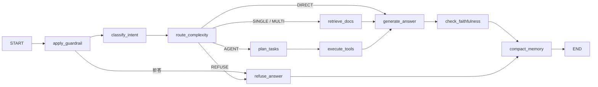

# 01 · 架构

## 请求链路

```text
HTTP / SSE → ChatService → LangGraph → 检索 或 工具 → Provider / DB
```

- `app/asgi.py`：ASGI 入口，绑定 `AppContainer`。
- `app/services/chat_service.py`：会话、限流、待确认操作、SSE。
- `app/services/container.py`：按配置装配 LLM、检索、重排、工具与数据库，依赖不可用时降级。
- `app/agents/graph.py`：状态机。

## Graph



## 五路分流

| 策略 | 触发 | 处理 |
|:---|:---|:---|
| `DIRECT` | 问候、闲聊 | 直接生成，不检索 |
| `SINGLE` | 单条 SOP / 制度 | 一轮 BM25 + 向量 + RRF + 精排 |
| `MULTI` | 多条件、跨文档 | 查询改写、补检、Self-RAG 最多 3 跳 |
| `AGENT` | 工单、资产、写操作、转人工 | 规划后调用受权限约束的工具 |
| `REFUSE` | 越界、注入、证据不足 | 拒答或转人工 |

显式 `TKT` / `AST` 编号一律走 `AGENT`，不受 LLM 路由结果影响。

## 关键设计

- **状态不可变追加**：`TypedDict` 部分更新，消息在 memory 节点显式压缩，避免预算被静默撑爆。
- **证据绑定**：检索块带稳定 `chunk_id`，回答只能引用实际返回的块。
- **降级可见**：`/api/v1/health` 与 `/capabilities` 报告数据库、缓存、向量库、检索、精排、LLM 的真实后端。
- **写操作先落单**：`AGENT` 只生成 `pending_action`，确认后才执行。

## 目录

```text
app/
  api/            HTTP 路由与 SSE
  services/       ChatService、容器、种子数据
  agents/         LangGraph 节点与状态
  retrieval/      切块、BM25、向量、RRF、Self-RAG
  tools/          10 个工具、注册表、权限
  repositories/   工单、资产、审批、会话、幂等
  guardrails/     注入、边界、忠实度
  memory/         上下文预算与压缩
  observability/  日志、指标、trace
knowledge/        31 篇 SOP
eval/             3 套离线集与 runner
tests/            unit / integration / e2e
```
